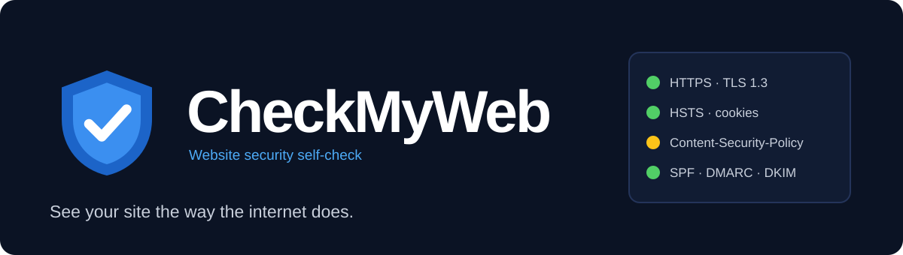

<p align="center">
  
</p>

<p align="center">
  <strong>내 웹사이트를 밖에서 보듯 점검합니다.</strong><br>
  HTTPS·보안 헤더·노출 파일·메일 도메인 점검 · 서버에 맞춘 조치 방법 · HTML/JSON 보고서
</p>

<p align="center">
  <a href="https://wookly.dev/products/checkmyweb/">제품 안내 및 무료 다운로드</a> ·
  <a href="#시작하기">시작하기</a> ·
  <a href="#소스에서-실행과-빌드">소스에서 실행과 빌드</a> ·
  <a href="https://github.com/wookly-dev/CheckMyWeb/issues">버그 제보</a>
</p>

---

## CheckMyWeb

CheckMyWeb은 내 웹사이트의 보안 설정을 외부에서 점검하는 명령줄 도구입니다.
서버에는 아무것도 설치하지 않으며, 감지한 서버(Apache·nginx·IIS·LiteSpeed·Caddy, PHP·Node.js·Django·ASP.NET·Java)와 CDN에 맞는 설정 예시를 함께 보여 줍니다.

| 점검 | 확인하는 내용 |
|---|---|
| HTTPS와 인증서 | 인증서 만료·체인·키 길이, TLS 1.0/1.1 허용, 취약 암호, HTTP→HTTPS 전환, HSTS |
| 보안 헤더와 쿠키 | CSP, 클릭재킹 방어, nosniff, Referrer-Policy, 세션 쿠키 속성, CORS |
| 노출 파일 | .git·.env·백업·DB 덤프·관리 도구·디렉터리 목록 (도메인 소유 확인 후) |
| 메일 도메인 | SPF·DMARC·DKIM, 메일 서버 PTR, MTA-STS, CAA, DNSSEC |
| 보고서 | 등급과 우선 조치 항목이 담긴 HTML·JSON 보고서, 여러 사이트 일괄 점검 |

**현재 배포: 1.0.2 · 무료 · Python 3.11 이상 · Windows에서 검증**

## 시작하기

1. [제품 페이지](https://wookly.dev/products/checkmyweb/)에서 ZIP을 받습니다.
2. ZIP을 원하는 폴더에 풀고, 함께 들어 있는 사용 설명서(`manual.html`)와 사용권(`LICENSE.txt`)을 확인합니다.
3. 그 폴더에서 명령 프롬프트를 열고 `checkmyweb.cmd example.com`처럼 실행합니다. `example.com` 자리에는 점검할 내 사이트 주소를 넣습니다.
4. 본인 소유이거나 점검 권한을 받은 사이트에만 사용합니다.

### 점검 방식과 한계

- HTTP로는 GET·HEAD·OPTIONS·TRACE 요청만 보냅니다. 선택 기능인 포트 점검은 TCP 연결과 메일 서버의 인사말·기능 목록 조회만 합니다. 로그인 시도·쓰기 요청·공격 코드는 보내지 않습니다.
- 민감 파일 노출 점검과 포트 점검은 DNS TXT 레코드나 확인 파일로 도메인 소유를 확인한 대상에서만 실행합니다.
- DNS 조회에는 Cloudflare와 Google의 공개 DNS-over-HTTPS 서비스를 사용합니다. 점검 결과는 WooklyDev로 전송되지 않습니다.
- 자동 점검은 홈페이지와 정해진 경로만 확인합니다. 결과에 나타나지 않은 문제가 없다는 뜻은 아닙니다.
- macOS·Linux에서도 `python3 checkmyweb.pyz`로 실행하도록 만들었지만 아직 직접 검증하지 않았습니다.

## 개인정보와 제보

보고서에는 점검한 사이트의 약점이 담깁니다. 공개 이슈에 실제 점검 보고서, 점검한 사이트의 주소·IP,
소유 확인 토큰, 서버 설정 파일, 인증정보, 개인·고객 자료를 올리지 마세요.
오류는 `example.com` 같은 합성 예제와 재현 순서로 설명해 주세요. 취약점 제보는 [보안 안내](SECURITY.md)를 확인해 주세요.

## 소스에서 실행과 빌드

Python 3.11 이상만 있으면 되며 추가 패키지는 없습니다. 저장소 루트에서 실행합니다.

```powershell
git clone https://github.com/wookly-dev/CheckMyWeb.git
cd CheckMyWeb
python -m checkmyweb --help
python scripts/build_release.py
```

`build_release.py`는 배포본과 같은 5개 파일(`checkmyweb.pyz`, `checkmyweb.cmd`, `README.txt`, `manual.html`, `LICENSE.txt`)로
`dist/CheckMyWeb-<버전>.zip`과 `SHA256SUMS.txt`를 만듭니다. ZIP 항목의 시각을 고정하므로 같은 버전을 다시 빌드하면 같은 바이트가 나옵니다.
`v1.0.2` 태그에서 빌드한 ZIP은 제품 페이지에 게시된 1.0.2 ZIP과 SHA-256이 같습니다.

### 합성 테스트

```powershell
python -m unittest discover -s tests
```

통합 테스트는 127.0.0.1에 띄우는 합성 테스트 사이트(`tests/fixture_server.py`)만 점검하며 실제 사이트에는 요청을 보내지 않습니다.
테스트용 인증서는 처음 실행할 때 openssl로 만듭니다. openssl이 없으면 통합 테스트를 건너뜁니다.
설명서와 제품 화면 이미지는 같은 합성 사이트를 Microsoft Edge로 찍어 만듭니다(`scripts/make_screenshots.py`).

`SOURCE_MANIFEST.sha256`는 이 저장소에 저장된 원본 파일의 체크섬입니다.

## 공개 범위와 저작권

Copyright © 2026 WooklyDev. All rights reserved.

이 저장소는 제품 소스를 열람할 수 있도록 공개합니다. 별도의 오픈소스 라이선스를 부여하지 않으며, 기존 저작권을 유지합니다.
배포 프로그램의 무료 사용 조건은 다운로드 ZIP의 `LICENSE.txt`(이 저장소의 `packaging/LICENSE.txt`와 같은 내용)를 확인하세요.
개발자가 제공하는 배포본과 안내는 [공식 제품 페이지](https://wookly.dev/products/checkmyweb/)에서 확인할 수 있습니다.

## English

CheckMyWeb is a command-line tool that checks your website's security settings from the outside: HTTPS and certificates,
security headers and cookies, exposed files and mail domain records. It suggests configuration for the server and CDN it detects
and writes HTML and JSON reports. The interface and manual are in Korean.

The current release is **1.0.2, free, Python 3.11 or later, tested on Windows**. Use it only on sites you own or are authorized
to test. Exposed-file and port checks run only after domain ownership is verified. macOS and Linux have not been tested yet.

Use synthetic examples in public reports; do not attach real scan reports, verification tokens, credentials or personal/customer data.
This public source retains its existing copyright; no additional open source license is granted.
